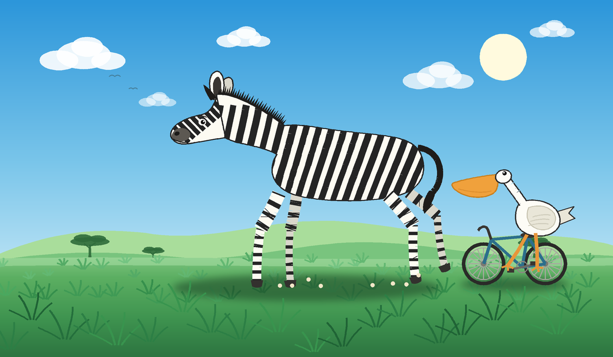

# 草原上奔跑的斑马 · Galloping Zebra

一个纯 SVG 的动画场景：斑马在草原上奔驰，旁边一只鹈鹕骑着自行车。

- **技术**：SVG + SMIL 动画，**不含 JavaScript，也没有 CSS**
- **尺寸**：`viewBox="0 0 1200 700"`，随窗口自适应缩放
- **打开方式**：用浏览器直接打开 `zebra-running.svg`（双击即可），动画自动播放

## 动画清单

| 部件 | 效果 | 周期 |
| --- | --- | --- |
| 斑马四条腿 | 大腿绕髋、小腿绕膝，四腿相位错开 | 0.7 s |
| 斑马躯干 | 随步伐上下起伏 | 0.35 s |
| 斑马尾巴 | 甩动 | 0.9 s |
| 蹄下尘土 | 8 团尘雾扩散、上升、淡出 | 0.9 s |
| 地面阴影 | 呼吸式收缩 | 0.7 s |
| 草丛（远/中/近三层） | 三层视差平移，每丛草各自摇摆 | 8.4 / 6.4 / 4.6 s |
| 自行车轮 | 辐条连续旋转 | 1.15 s |
| 曲柄与脚踏 | 整圈转动 | 0.9 s |
| 鹈鹕双腿 | 绕髋摆动，左右反相 | 0.9 s |
| 鹈鹕身体 | 随颠簸浮动 | 0.45 s |
| 云 / 太阳光晕 / 飞鸟 | 漂移 / 脉动 / 起伏 | 13 / 7 / 3.2 s |

## 实现要点

- 斑马与鹈鹕的轮廓用贝塞尔曲线手工绘制；身体条纹通过 `clipPath` 裁在轮廓内，腿上的横纹用 `stroke-dasharray` 画出环带。
- 所有旋转都用 `<animateTransform type="rotate">` 并显式给出旋转中心，避免依赖 CSS `transform-origin` 的浏览器差异。
- 场景朝左运动：背景向右平移，蹄下尘土向右后方飘散。
- 支持 `prefers-reduced-motion` 之外的所有现代浏览器（Chrome / Edge / Firefox / Safari）。

## 文件

| 文件 | 说明 |
| --- | --- |
| `zebra-running.svg` | 动画主体，可直接嵌入 `` / `<object>` 或当作独立页面 |
| `preview.png` | 首帧静态预览（近似光栅化，仅作示意） |

## English

An animated SVG scene: a zebra gallops across a savanna while a pelican rides a
bicycle alongside. Pure SVG + SMIL — no JavaScript, no CSS. Open
`zebra-running.svg` in any modern browser and it plays on load.
